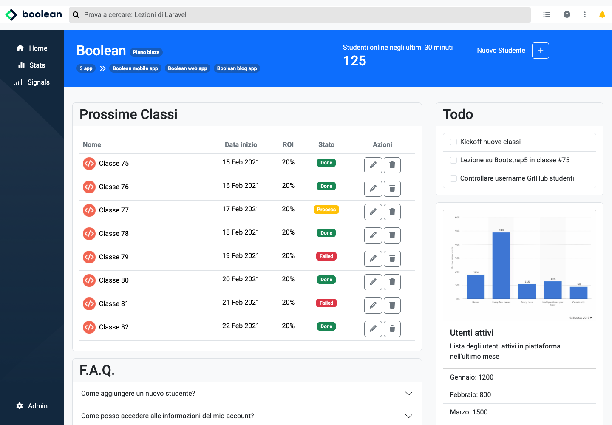

# Bootstrap Dashboard

A recreation of a responsive school dashboard, built as an individual project during the Boolean programme in **October 2023**. Based on assigned screenshots, the exercise focuses on HTML structure, the Bootstrap grid and adapting content to different screens.

**[Open the demo](https://massimoperuga.dev/en/demo/bootstrap-dashboard)** · [Project in my portfolio](https://massimoperuga.dev/en/formazione/boolean#bootstrap-dashboard) · [Italiano](README.md)

[](https://massimoperuga.dev/en/demo/bootstrap-dashboard)

[See the mobile view](docs/images/dashboard-mobile.png). The [original assignment](CONSEGNA.md), in Italian, is preserved in full.

## What it includes

- Top navigation, sidebar and a summary with plan information and online students.
- A class table with dates, statuses and actions, alongside Todo items and sample statistics.
- A “Nuovo Studente” side panel, expandable FAQs and a dropdown menu.
- Columns, labels and logos that change layout or visibility at Bootstrap breakpoints.

## My work

I recreated the layout from the assigned screenshots, organising navigation, a table, forms and information panels on one page. I used the grid and responsive classes to adapt columns and make room for essential content on smaller devices.

## Stack and technical choices

| Area | Technologies |
| --- | --- |
| Structure | HTML |
| Layout and interactions | Bootstrap 5 |
| Customisation | CSS |
| Typography and icons | Roboto, Font Awesome |

- **Grid and visibility classes:** rearrange panels and hide secondary table columns as space decreases.
- **Bootstrap components:** offcanvas, accordion and dropdown are activated through `data-bs-*` attributes, without additional application JavaScript.
- **Internal scrolling:** the content area scrolls while top navigation and the sidebar remain available.

Code entry points: [index.html](index.html), [main styles](CSS/_partials/main.css) and [layout variables](CSS/_partials/variables.css).

## Running locally

You need **Python 3**, a current browser and an Internet connection for Bootstrap, Font Awesome and Google Fonts loaded from CDNs.

```sh
git clone https://github.com/MassimoPeruga/html-css-bootstrap-dashboard.git
cd html-css-bootstrap-dashboard
python3 -m http.server 5180 --bind 127.0.0.1
```

Open [http://127.0.0.1:5180](http://127.0.0.1:5180). No npm, build, database or credentials are required. Press `Ctrl+C` to stop the server.

Startup and interactions were checked with Python 3.14.0 and Chrome at desktop, tablet and mobile widths: the student panel, form reset, FAQs, Todo checkboxes, dropdown menu and content scrolling.

## Original project and portfolio demo

The dashboard uses sample data; the chart is a static image. Search, saving students and management actions are not connected to a backend.

The portfolio demo adds local class filtering, explanatory messages for demo actions, locally served dependencies and adjustments to the site’s breakpoints. These changes live in the [portfolio adaptations](https://github.com/MassimoPeruga/portfolio/tree/production/site/demos), separately from this repository’s sources. The interface retains its original Italian content.
