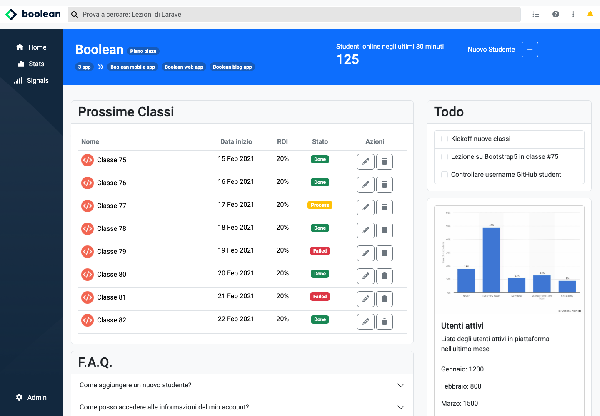

# Bootstrap Dashboard

Riproduzione di una dashboard scolastica responsive, realizzata come progetto individuale del percorso Boolean nell’**ottobre 2023**. L’esercizio parte da schermate assegnate e si concentra su struttura HTML, griglia Bootstrap e adattamento dei contenuti ai diversi schermi.

**[Apri la demo](https://massimoperuga.dev/demo/bootstrap-dashboard)** · [Il progetto nel portfolio](https://massimoperuga.dev/formazione/boolean#bootstrap-dashboard) · [English](README.en.md)

[](https://massimoperuga.dev/demo/bootstrap-dashboard)

[Vedi la vista mobile](docs/images/dashboard-mobile.png). La [consegna originale dell’esercizio](CONSEGNA.md) è conservata integralmente.

## Cosa include

- Navigazione superiore, sidebar e riepilogo con piano e studenti online.
- Tabella delle classi con date, stati e azioni, affiancata a Todo e statistiche dimostrative.
- Pannello laterale “Nuovo Studente”, FAQ espandibili e menu a discesa.
- Colonne, etichette e loghi che cambiano disposizione o visibilità ai breakpoint Bootstrap.

## Il mio lavoro

Ho ricostruito il layout dalle schermate assegnate, organizzando navigazione, tabella, form e pannelli informativi in un’unica pagina. Ho usato griglia e classi responsive per adattare le colonne e lasciare spazio ai contenuti essenziali sui dispositivi più piccoli.

## Stack e scelte tecniche

| Ambito | Tecnologie |
| --- | --- |
| Struttura | HTML |
| Layout e interazioni | Bootstrap 5 |
| Personalizzazione | CSS |
| Tipografia e icone | Roboto, Font Awesome |

- **Griglia e classi di visibilità:** riorganizzano i pannelli e nascondono le colonne secondarie della tabella quando lo spazio diminuisce.
- **Componenti Bootstrap:** offcanvas, accordion e dropdown sono attivati tramite attributi `data-bs-*`, senza JavaScript applicativo aggiuntivo.
- **Scorrimento interno:** l’area dei contenuti scorre mantenendo disponibili navigazione superiore e sidebar.

Punti d’ingresso: [index.html](index.html), [stili principali](CSS/_partials/main.css) e [variabili di layout](CSS/_partials/variables.css).

## Avvio locale

Servono **Python 3**, un browser aggiornato e una connessione Internet per Bootstrap, Font Awesome e Google Fonts caricati da CDN.

```sh
git clone https://github.com/MassimoPeruga/html-css-bootstrap-dashboard.git
cd html-css-bootstrap-dashboard
python3 -m http.server 5180 --bind 127.0.0.1
```

Apri [http://127.0.0.1:5180](http://127.0.0.1:5180). Non sono necessari npm, build, database o credenziali. Per fermare il server premi `Ctrl+C`.

Avvio e interazioni sono stati verificati con Python 3.14.0 e Chrome a larghezze desktop, tablet e mobile: pannello studente, reset del form, FAQ, Todo, menu a discesa e scorrimento dei contenuti.

## Progetto originale e demo del portfolio

I dati della dashboard sono dimostrativi; il grafico è un’immagine statica. Ricerca, salvataggio degli studenti e azioni di gestione non sono collegati a un backend.

La demo del portfolio aggiunge un filtro locale delle classi, messaggi esplicativi per le azioni dimostrative, dipendenze locali e adattamenti ai breakpoint del sito. Questi interventi risiedono negli [adattamenti del portfolio](https://github.com/MassimoPeruga/portfolio/tree/production/site/demos), separati dai sorgenti di questa repository. L’interfaccia mantiene i contenuti originali in italiano.
